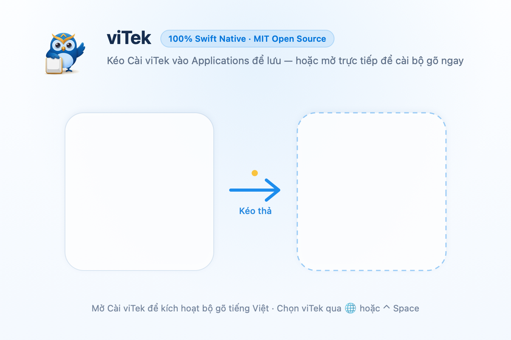

<div align="center">

<p>
  
  &nbsp;&nbsp;&nbsp;
  
</p>

# viTek

**100% Swift 6 Native Vietnamese Input Method · MIT Open Source for Apple Silicon, iPhone & iPad**

**[🇻🇳 Tiếng Việt](README.md)** | **🇬🇧 English**

[](LICENSE)
[](#getting-started)
[](Package.swift)
[](https://github.com/luongbinhf/viTek/releases)

</div>

---

**viTek** is a **100% Swift 6 Native** Vietnamese input method crafted exclusively for **macOS 14+** and **iOS / iPadOS 26+**. The core orthography engine (`VitekEngine`) and document session (`VitekSession`) share a single pure-Swift codebase that runs completely on-device — zero FFI bridges, zero Accessibility permission needed to type, and zero keystroke telemetry.

## Visual Drag-and-Drop DMG Installer

<div align="center">
  
</div>

## Getting Started

- **macOS (Homebrew Cask):**
  ```sh
  brew tap luongbinhf/vitek https://github.com/luongbinhf/viTek
  brew install --cask luongbinhf/vitek/vitek
  ```
- **macOS (DMG):** Download the latest `.dmg` from [GitHub Releases](https://github.com/luongbinhf/viTek/releases), drag **Cài viTek** to `Applications`, and open it once to register and enable **viTek** (`🌐` or `⌃ Space`). See [Installation Guide](docs/INSTALL.md).
- **Build from Source (macOS):** Run `CONFIGURATION=Release scripts/install_dev.sh` (requires Apple Silicon, Xcode with macOS 26+ SDK, and XcodeGen).
- **iPhone & iPad:** Generate `Apps/iOS/viTekMobile.xcodeproj` with `xcodegen generate --spec Apps/iOS/project.yml`, then enable **viTek** under **Settings → General → Keyboard → Keyboards**. Full Vietnamese typing and local word/emoji predictions work even with *Allow Full Access* turned off.

Try typing `vieetj vie65t reset server userName github.com ` → expected output: **`việt việt reset server userName github.com `**.

## Highlights

| Area | Capabilities |
|---|---|
| **Smart Bilingual Typing** | Per-word **Telex & VNI auto-detection**, instant **`VI ↔ EN`** toggle (`⌥⌥` double-tap with Liquid Glass HUD on macOS / `VI/EN` key on iOS), free tone placement, Modern (`hoà`) / Traditional (`hòa`) orthography, optional quick consonants, instant **`Esc`** raw-key undo |
| **English & Code Protection** | Automatic restoration of non-Vietnamese words, protection for **304+ everyday English words** + bilingual context disambiguation, **Smart Token Bypass** (`camelCase`, `snake_case`, URLs, emails, `self.view`), personal exception dictionary |
| **Per-App Auto-Switch & Focus** | Automatically switches to English in Terminal, iTerm2, Warp, Ghostty, Alacritty, and Kitty via IMK `bundleIdentifier` (no Accessibility permission required) + **Apple Focus Filter** (`SetFocusFilterIntent`) |
| **Encoding & Case Tools** | Pure-Swift `TextConverter` with **automatic legacy font repair** (`autoConvertToUnicode`), **Unicode NFC**, **accent stripping**, **VNI Windows / TCVN3 → Unicode**, and **UPPER / lower / Title Case** available from macOS menu bar, iOS keyboard (`Aa`), and **Apple Shortcuts** |
| **Rock-Solid Web & Electron** | `DocumentSession` with verified UTF-16 ranges, inline omnibox autocomplete in Chrome/Safari/Spotlight, zero synthetic Backspace hacks |
| **Macros & iCloud Sync** | Case-preserving text shortcuts (`ko` / `Ko` / `KO`), dynamic `{{date}}` / `{{time}}` / `{{datetime}}` variables, import from viTek / UniKey / OpenKey / CSV, seamless iCloud sync across Mac, iPhone & iPad |
| **On-Device Suggestions & Emoji** | Built-in **784 entries / 646 words**, bilingual Vietnamese/English Emoji search, and adaptive `PersonalFrequency` ranking |
| **Adaptive iOS / iPadOS & Widgets** | Portrait **Left/Right One-Handed mode**, landscape & iPad **Split Keyboard**, flick-down keys for numbers/symbols, **Hardware / Magic Keyboard support** (`pressesBegan`), Apple Intelligence (`FoundationModels`), Widgets & Control Center |
| **Security & Auto-Updater** | Privacy Manifest (`PrivacyInfo.xcprivacy`), Vietnamese/English UI localization, and 1-click **SHA-256 verified** GitHub Releases updates ([SECURITY.md](SECURITY.md)) |

## Versioning Scheme (`YYYYMMDD.X.YYY`)

Every release uses clean date-based versioning **`YYYYMMDD.X.YYY`**:
- **`YYYYMMDD`**: Release date (e.g. `20261125`).
- **`X`**: Major release counter for that date (`1`, `2`, …).
- **`YYY`**: 3-digit zero-padded build number for macOS & GitHub Releases (`002`). On iOS (`Apps/iOS/Config/Version.xcconfig`), leading zeros are stripped (`20261125.1.2`) for Apple App Store Connect compliance.

## Measured Performance (Apple Silicon)

- **Core Engine (`swift run -c release vitek-bench`, 52,400 keys):** p50 **0.88 µs**, p99 **2.54 µs** (~20× faster than the 50 µs budget).
- **Word & Emoji Predictions (`swift run -c release vitek-prediction-bench`, 16,000 queries):** p50 **20.5 µs**, p99 **72.9 µs** (>100× faster than a 120Hz ProMotion frame).

## Build & Test

```sh
scripts/version.sh check
swift test
swift run vitek "Tooi yeeu tieengs Vieetj"
swift run -c release vitek-bench
swift run -c release vitek-prediction-bench
scripts/release.sh --local
```

## Contributing & License

Contributions are welcome! See [CONTRIBUTING.md](CONTRIBUTING.md), [CHANGELOG.md](CHANGELOG.md), and [SOURCES.md](SOURCES.md) for clean-room licensing rules.

**viTek** is released under the **[MIT License](LICENSE)** (`Copyright © 2026 Binh Luong / viTek Contributors`).
