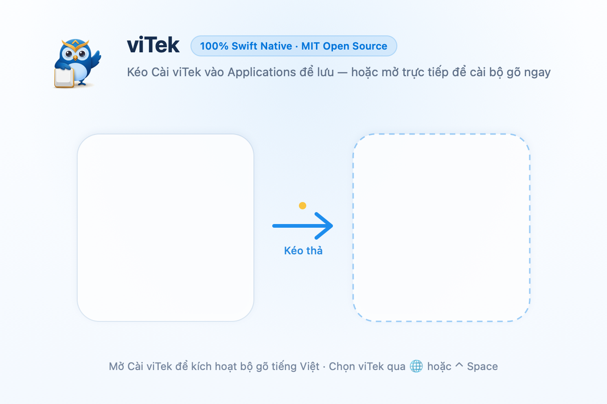

<div align="center">

<p>
  
  &nbsp;&nbsp;&nbsp;
  
</p>

# viTek

**Bộ gõ tiếng Việt 100% Swift 6 Native · Mã nguồn mở cho hệ sinh thái Apple**

**🇻🇳 Tiếng Việt** | **[🇬🇧 English](README.en.md)**

[](LICENSE)
[](#bắt-đầu)
[](Package.swift)
[](https://github.com/luongbinhf/viTek/releases)

</div>

---

**viTek** là bộ gõ tiếng Việt **100% Swift 6 Native** dành riêng cho **macOS 14+** và **iOS / iPadOS 26+**. Lõi xử lý (`VitekEngine`) và phiên soạn thảo (`VitekSession`) dùng chung hoàn toàn trên thiết bị — không cầu nối FFI, không cần quyền Trợ năng để gõ, không thu thập hay gửi văn bản đang gõ ra ngoài.

Linh vật của dự án là **Cú Lạc viTek** mang vương miện dấu mũ vàng (`^`) và phím gõ trắng, đại diện cho tinh thần tiếng Việt hiện đại, thông minh và mở.

## Trải nghiệm cài đặt trực quan (macOS DMG)

<div align="center">
  
</div>

## Bắt đầu

- **macOS (Homebrew Cask):**
  ```sh
  brew tap luongbinhf/vitek https://github.com/luongbinhf/viTek
  brew install --cask luongbinhf/vitek/vitek
  ```
- **macOS (DMG):** tải bản phát hành mới nhất tại [GitHub Releases](https://github.com/luongbinhf/viTek/releases), mở tệp `.dmg`, kéo **Cài viTek** vào `Applications` (hoặc mở trực tiếp **Cài viTek**) để cài đặt nguyên tử và bật nguồn nhập **viTek** (`🌐` hoặc `⌃ Space`). Xem thêm [hướng dẫn cài đặt](docs/INSTALL.md).
- **Build từ mã nguồn (macOS):** chạy `CONFIGURATION=Release scripts/install_dev.sh` tại thư mục dự án. Yêu cầu Apple Silicon, Xcode SDK macOS 26+ và XcodeGen (deployment target: macOS 14.0).
- **iPhone / iPad:** build `Apps/iOS/viTekMobile.xcodeproj` (tạo bằng `xcodegen generate --spec Apps/iOS/project.yml`), thêm **viTek** trong **Cài đặt → Cài đặt chung → Bàn phím → Bàn phím**, giữ phím quả địa cầu để chọn. Bàn phím gõ đầy đủ tiếng Việt và gợi ý cục bộ ngay cả khi tắt *Cho phép truy cập đầy đủ*. Xem [hướng dẫn App Store](docs/APPSTORE.md).

Gõ thử chuỗi phím `vieetj vie65t reset server userName github.com ` → kết quả mong đợi là **`việt việt reset server userName github.com `**.

## Tính năng chính

| Nhóm | Hành vi & Ưu điểm |
|---|---|
| **Gõ tiếng Việt thông minh** | Tự nhận **Telex & VNI** theo từng từ, chuyển nhanh **`VI ↔ EN`** 0 ms (nhấn đúp **`⌥`** trên macOS / nút **`VI/EN`** trên iOS), đặt dấu tự do, kiểu dấu mới (`hoà`) / cũ (`hòa`), tuỳ chọn **gõ tắt phụ âm đầu/cuối**, bấm **`Esc`** hoàn tác ngay về phím gốc |
| **Chống phá từ Anh & Code** | Khôi phục từ không hợp chính tả, bảo vệ **304 từ tiếng Anh** thông dụng + nhận diện ngữ cảnh tiếng Anh, **Smart Token Bypass** (`camelCase`, `snake_case`, URL, email, `self.view`), **Từ ngoại lệ cá nhân** |
| **Tự tắt tiếng Việt theo app & Focus** | Tự chuyển tiếng Anh trong Terminal, iTerm2, Warp, Ghostty, Alacritty, Kitty… qua `bundleIdentifier` của IMK (không cần quyền Trợ năng) và tích hợp **Apple Focus Filter** (`SetFocusFilterIntent`) |
| **Công cụ Chuyển mã & Clipboard** | `TextConverter` thuần Swift **tự động nhận diện & sửa lỗi font** (`autoConvertToUnicode`), chuẩn hoá **Unicode NFC**, **bỏ dấu**, chuyển mã **VNI Windows / TCVN3 → Unicode**, đổi **CHỮ HOA / chữ thường / Viết Hoa Đầu Từ** ngay trên menu macOS và **Apple Shortcuts** |
| **Ổn định trên Web & Electron** | `DocumentSession` xác minh vùng UTF-16, hỗ trợ **Chrome/Safari Omnibox & Spotlight inline autocomplete**, không gửi Backspace giả |
| **Gõ tắt động & Đồng bộ iCloud** | Giữ kiểu hoa (`ko` / `Ko` / `KO`), mẫu nhiều dòng, biến động **`{{date}}` / `{{time}}` / `{{datetime}}`**, tuỳ chọn gõ tắt cả khi tắt tiếng Việt, nhập **viTek / UniKey / OpenKey / CSV**, đồng bộ macOS ↔ iOS qua iCloud |
| **Gợi ý từ, Emoji & Học cá nhân** | Kho **784 mục / 646 từ** + từ khoá **Emoji** Việt/Anh + bộ nhớ tần suất cá nhân (`PersonalFrequency`). Trên macOS chọn bằng **`⌥1`–`⌥5` hoặc click chuột trực tiếp** trên thanh nổi Liquid Glass không mất tiêu điểm |
| **Apple Intelligence & Widgets** | Dùng `FoundationModels` trên thiết bị (macOS/iOS 26+), hỗ trợ **App Shortcuts**, **Interactive Home/Lock Screen Widgets** và **Control Center (`ControlWidget`)** |
| **Bàn phím iOS & iPadOS thích ứng** | Bố cục **gõ một tay (trái / phải)** khi cầm dọc, **chia đôi bàn phím (Split Keyboard)** hai cụm ngón cái khi xoay ngang & trên iPad, **vuốt xuống phím chữ** để gõ nhanh số/ký hiệu, tự tắt dấu trong ô **URL/Email** kèm phím `@` `/` `.`, phím **Return theo ngữ cảnh** (`Tìm`/`Đi`/`Gửi`/`Xong`), bảng **Emoji (`😀`)** tìm theo từ khoá tiếng Việt (`🔍`), giữ **⌫** xoá liên tục, kéo **Dấu cách** di chuyển con trỏ |
| **Quyền riêng tư & Bản địa hoá** | Kèm Apple Privacy Manifest (`PrivacyInfo.xcprivacy`), bản địa hoá Việt/Anh (`Localizable.xcstrings`), kiểm tra bản cập nhật GitHub Releases theo yêu cầu & kiểm tra kết nối 1 chạm trong Cài đặt |

> **Lưu ý về quyền Trợ năng (macOS):** Gõ tiếng Việt, sửa từ vừa chốt và tự tắt tiếng Việt theo app **không cần** quyền Trợ năng. Quyền này chỉ cần nếu bạn bật thanh gợi ý từ trong Chrome/Electron để đọc toạ độ con trỏ qua `AccessibilityCaret`.

## Quy tắc phiên bản & Phát hành (`YYYYMMDD.X.YYY`)

Mỗi bản phát hành chính thức của viTek sử dụng định dạng rõ ràng **`YYYYMMDD.X.YYY`**:
- **`YYYYMMDD`**: ngày phát hành theo lịch dương (ví dụ `20261125`).
- **`X`**: đợt phát hành lớn trong ngày / chu kỳ (`1`, `2`, …).
- **`YYY`**: số thứ tự bản dựng có 3 chữ số trên macOS & GitHub Releases (`001`, `002`, …). Riêng cấu hình iOS (`Apps/iOS/Config/Version.xcconfig`) tự động rút gọn số `0` đệm đầu (`20261125.1.1`) để tuân thủ chuẩn Apple App Store Connect.

```sh
scripts/version.sh check         # Kiểm tra đồng bộ phiên bản macOS + iOS
scripts/version.sh bump build    # 20261125.1.001 → 20261125.1.002
scripts/version.sh bump release  # 20261125.1.001 → 20261125.2.001
scripts/version.sh bump date     # Cập nhật sang YYYYMMDD hôm nay .1.001
```

## Hiệu năng đã đo (Apple Silicon)

- **Lõi gõ phím (`swift run -c release vitek-bench`, 52.400 phím):** p50 **0,88 µs**, p99 **2,54 µs** (nhanh hơn ~20× ngân sách 50 µs nhờ chỉ mục vần O(1) và đệm ASCII nội tuyến).
- **Gợi ý từ & Emoji cục bộ (`swift run -c release vitek-prediction-bench`, 16.000 truy vấn):** p50 **20,5 µs**, p99 **72,9 µs** (~0,07 ms, nhanh hơn >100 lần một khung hình 120Hz ProMotion).

## Phát triển, Kiểm thử & Đóng gói

```sh
# Kiểm tra phiên bản, chạy toàn bộ unit test và benchmark
scripts/version.sh check
swift test
swift run vitek "Tooi yeeu tieengs Vieetj"
swift run -c release vitek-bench
swift run -c release vitek-prediction-bench

# Sinh project Xcode cho macOS & iOS
xcodegen generate --spec Apps/macOS/project.yml
xcodegen generate --spec Apps/iOS/project.yml

# Cài bản Release lên macOS đang dùng
CONFIGURATION=Release scripts/install_dev.sh

# Đóng gói DMG macOS (local ad-hoc hoặc Developer ID + Notarize)
scripts/release.sh --local

# Archive bản iOS cho TestFlight / App Store Connect
DEVELOPMENT_TEAM=XXXXXXXXXX scripts/archive_ios.sh
```

## Cấu trúc dự án

| Đường dẫn | Trách nhiệm |
|---|---|
| `Sources/VitekEngine` | Chính tả tiếng Việt, Telex/VNI, Smart Bypass và thói quen gõ; Swift thuần (không Foundation) |
| `Sources/VitekSession` | `DocumentSession`, `InputSession`, gõ tắt (viTek/UniKey/OpenKey/CSV), gợi ý từ, `EmojiSuggestions` và `PersonalFrequency` |
| `Sources/vitek-*` | CLI (`vitek`), benchmark phím (`vitek-bench`), benchmark gợi ý (`vitek-prediction-bench`), công cụ sinh danh sách từ |
| `Apps/macOS` | Host InputMethodKit (`viTek`), cửa sổ cài đặt SwiftUI (`@Observable`, Liquid Glass) và bộ cài nguyên tử (`viTekInstaller`) |
| `Apps/iOS` | App `viTekMobile`, bàn phím `viTekKeyboard`, `viTekWidgets`, `UITests` và bộ kiểm thử gõ phím `KeyboardTests` |
| `Apps/Shared` | Apple Intelligence (`WritingView`), `AppIntents`, `CloudSettingsSync`, `IOSKeyboardSettings`, `BrandMascot`, `Localizable.xcstrings`, `PrivacyInfo.xcprivacy` |
| `assets/brand` | Bộ nhận diện thương hiệu: Logo squircle, linh vật Cú Lạc (`vitek-mascot.png`) và nền DMG Retina (`dmg-background.tiff`) |
| `Tests` | Unit tests engine/session/repo, Cocoa harness, Installer smoke test và kiểm thử tương thích macOS |
| `docs` | Kiến trúc, đặc tả engine, UX, cài đặt, hướng dẫn App Store, lộ trình và báo cáo QA |
| `scripts` | Build, cài đặt dev, đóng gói DMG trực quan (`release.sh`), archive iOS (`archive_ios.sh`), quản lý phiên bản và tạo tài nguyên thương hiệu (`make_brand_assets.swift`) |

## Đóng góp & Giấy phép

Hoan nghênh mọi đóng góp, báo lỗi và Pull Request từ cộng đồng — xem [CONTRIBUTING.md](CONTRIBUTING.md) và [mục lục tài liệu](docs/README.md). Mã nguồn và dữ liệu tuân thủ [SOURCES.md](SOURCES.md): không sao chép từ bộ gõ khác, mọi nguồn bên ngoài đều có giấy phép sạch.

**viTek** được phát hành mã nguồn mở theo **[Giấy phép MIT](LICENSE)** (`Copyright © 2026 Binh Luong / viTek Contributors`).
